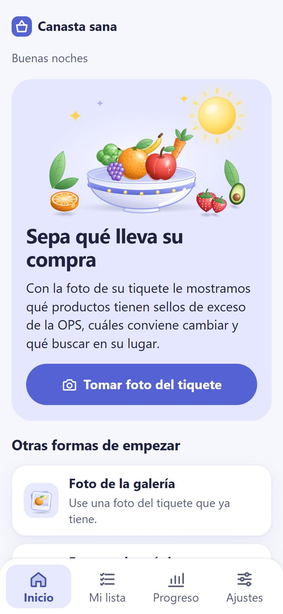
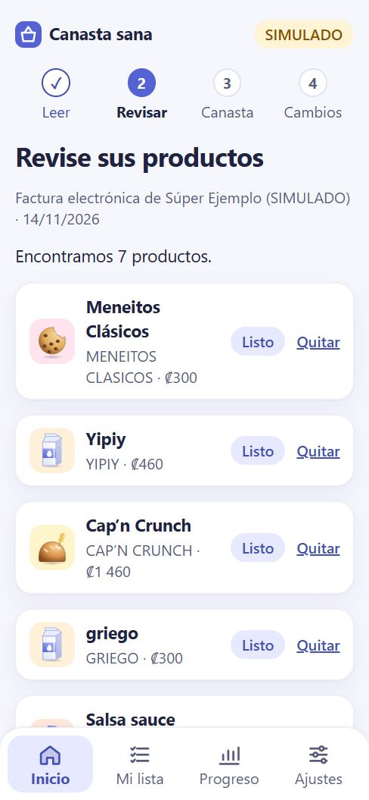
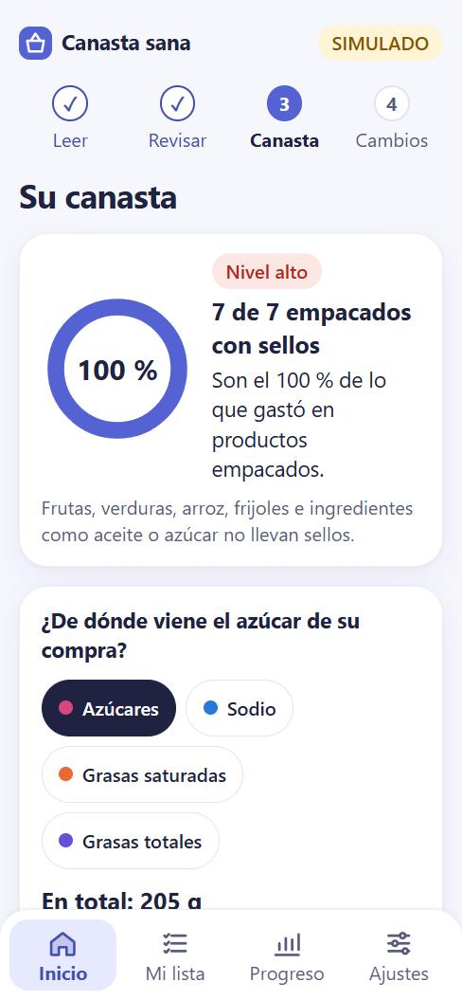
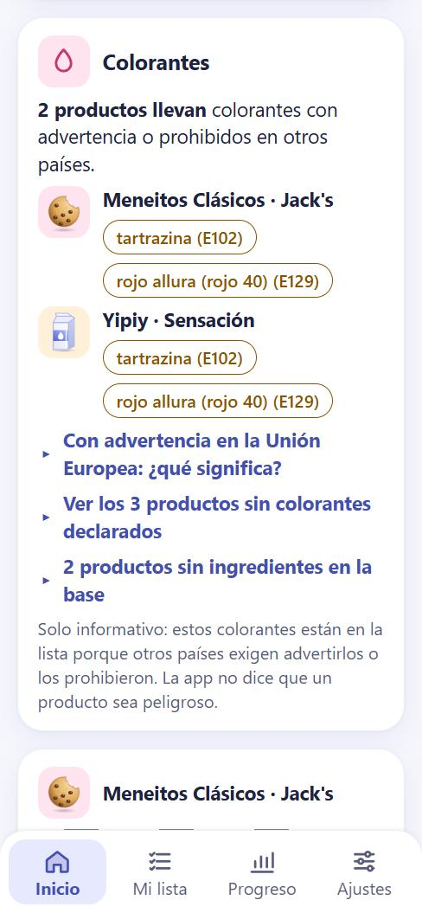
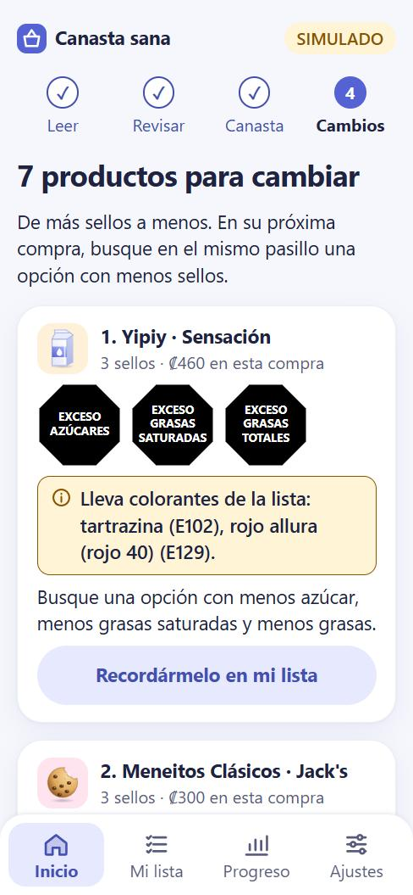
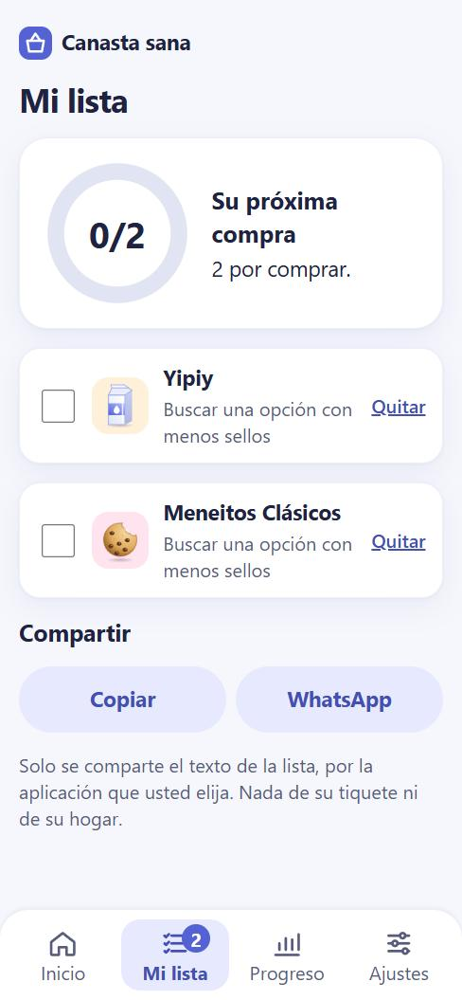
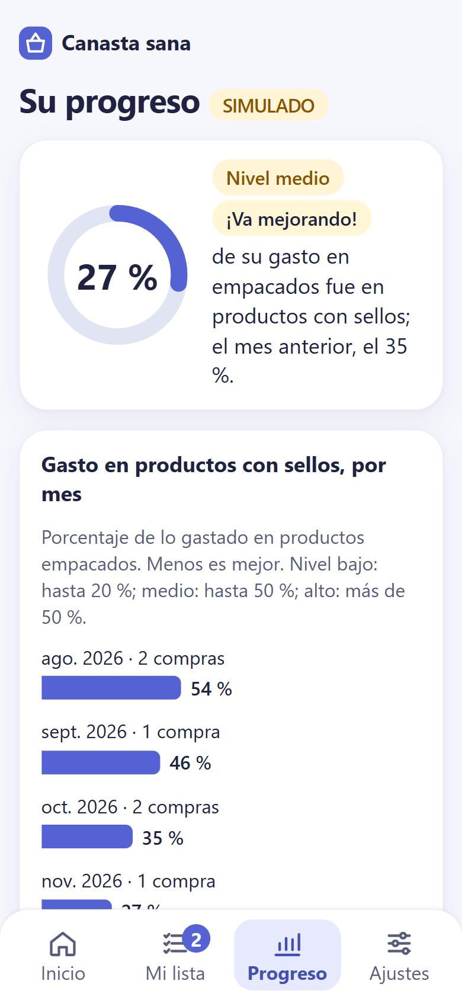
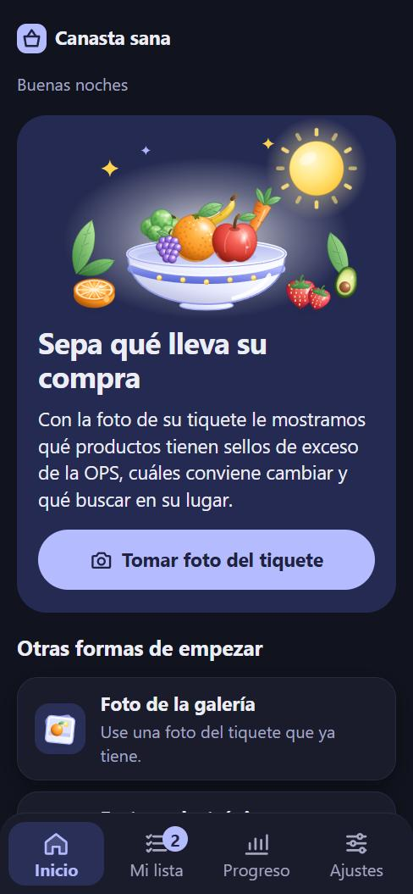
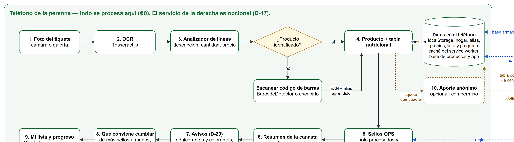

# Canasta sana

**Sepa qué lleva su compra.** Una app web (PWA) que lee el tiquete o la factura electrónica del supermercado y muestra, producto por producto, cuáles tienen exceso de azúcar, sodio o grasas según el modelo de la Organización Panamericana de la Salud (OPS). Todo se calcula dentro del teléfono: ni la foto ni la compra salen de él.

[](LICENSE)
[](LICENCIA-DATOS.md)


> **In short (English):** Canasta sana ("healthy basket") is an offline-first PWA for Costa Rica. It reads a supermarket receipt (photo OCR, PDF, pasted text or the official e-invoice XML), matches each item against an Open Food Facts product base, applies the PAHO 2016 nutrient-profile model, and flags excess sugar, sodium and fat plus food colorants that carry warnings or bans abroad. Everything runs on the phone: OCR (WebAssembly), PDF parsing and the nutrition engine. An optional FastAPI service collects anonymous community prices with k-anonymity. Built with React, TypeScript, Vite, Tesseract.js, PDF.js, FastAPI and SQLite.

## Capturas

<table>
  <tr>
    <td align="center"><br><sub>Inicio</sub></td>
    <td align="center"><br><sub>Revisar lo leído</sub></td>
    <td align="center"><br><sub>Resumen de la canasta</sub></td>
    <td align="center"><br><sub>Colorantes</sub></td>
  </tr>
  <tr>
    <td align="center"><br><sub>Qué conviene cambiar</sub></td>
    <td align="center"><br><sub>Mi lista</sub></td>
    <td align="center"><br><sub>Progreso</sub></td>
    <td align="center"><br><sub>Modo oscuro</sub></td>
  </tr>
</table>

Las capturas usan una compra **SIMULADA** (la app la marca así en pantalla) sobre la versión de producción, en un teléfono de 390 × 844 px.

## El problema

En Costa Rica, el 74,6 % de los adultos tiene sobrepeso u obesidad (32,3 % obesidad y 42,3 % sobrepeso, encuesta de la CCSS de 2024), y el etiquetado frontal de advertencia todavía no es obligatorio: el proyecto de ley sigue en la Asamblea Legislativa. Un estudio de la OPS con INCIENSA concluyó que los octágonos son el sistema que mejor ayuda a la gente de Costa Rica a reconocer los productos menos sanos. Fuentes completas en [`investigacion.md`](investigacion.md).

Canasta sana muestra esos octágonos sobre la compra real de cada hogar, sin pedir una cuenta, sin anuncios y sin costo.

## Qué hace

- **Lee la compra de cuatro formas:**
  - foto del tiquete, con OCR en el teléfono;
  - factura electrónica de Hacienda en XML (v4.3 y v4.4), la vía más exacta porque trae el código de barras de cada línea;
  - factura en PDF;
  - texto pegado de la factura.
- **Identifica cada producto** por código de barras (con validación del dígito de control GS1), por un alias aprendido o por palabras, abreviaturas y tamaño. Si tiene dudas, pregunta.
- **Calcula los sellos de la OPS (2016):** exceso de azúcares, sodio, grasas saturadas y grasas totales, más edulcorantes, solo en productos procesados y ultraprocesados.
- **Avisa de colorantes** que en la Unión Europea llevan advertencia obligatoria (E102, E104, E110, E122, E124 y E129), del dióxido de titanio (E171, prohibido en la UE desde 2022) y de la eritrosina (E127, revocada por la FDA en 2025). Es informativo: la app no dice que un producto sea peligroso.
- **Ordena qué conviene cambiar,** de más sellos a menos, y dice qué buscar en su lugar («una opción con menos azúcar»). No recomienda una marca concreta: con una base incompleta, una sugerencia automática puede salir absurda.
- **Mi lista y Progreso:** recordatorios para la próxima compra, que se comparten por WhatsApp, y la evolución mensual del gasto en productos con sellos.
- **Funciona sin conexión** una vez instalada, en modo claro u oscuro, con opción de letra Atkinson Hyperlegible y sin animaciones.

## Privacidad por diseño

- **La compra nunca sale del teléfono.** El OCR, el lector de PDF y el motor de sellos corren en el navegador; los datos se guardan en el almacenamiento local, con un botón para borrarlo todo y una copia de seguridad que la persona descarga.
- **Sin cuenta, sin anuncios, sin analítica.**
- **Política de seguridad de contenido (CSP) estricta** en producción: solo scripts propios, sin `unsafe-eval` (únicamente `wasm-unsafe-eval` para el OCR), `object-src 'none'`, `form-action 'none'` y `no-referrer`.
- **Servicio de precios opcional,** con permiso en cada compra:
  - recibe solo código, precio, cadena, cantón y semana, sin IP, hora ni dispositivo;
  - rechaza cualquier campo de más;
  - publica solo grupos de 3 aportes o más (k-anonimato) y solo semanas ISO ya cerradas, para que no se pueda deducir qué compró una persona;
  - la app descarga la tabla completa y busca ahí: no existe una consulta «precio de este producto».

## Arquitectura



| Parte | Tecnología |
|---|---|
| App web (PWA) | React 18, TypeScript 5.7, Vite 6, service worker propio |
| OCR | Tesseract.js 5 (WebAssembly) con el modelo de español, servido desde la propia app |
| PDF | PDF.js 4.8, con `isEvalSupported: false` |
| Código de barras en vivo | `BarcodeDetector` del navegador y `getUserMedia`; si no existe, foto o código escrito |
| Base de productos | 1235 productos de Costa Rica derivados de Open Food Facts |
| Servicio opcional | Python 3.14, FastAPI, Pydantic v2, SQLite, Docker |
| Pruebas | Vitest y pytest |

Detalles en [`arquitectura.md`](arquitectura.md) y en el [diagrama editable](diagramas/canasta_sana.drawio).

### Decisiones técnicas destacadas

- **Instalación ligera:** el service worker precarga solo la interfaz y la base de productos. El OCR (9,6 MiB) y PDF.js se guardan en caché la primera vez que se usan. La lista de precarga y la versión se generan al compilar, y la app avisa cuando hay una versión nueva en lugar de cambiarse sola.
- **Analizador de tiquetes tolerante:** une descripciones partidas en dos líneas, reconoce ₡ y ¢, descarta líneas de terminal y totales, y reconoce los códigos de 12 dígitos que algunos tiquetes imprimen sin el dígito de control del EAN-13.
- **Lector de factura electrónica** que extrae líneas, códigos, total, comercio y fecha, y **no lee los datos del receptor**.
- **Datos dudosos fuera:** si la energía declarada no cuadra con los macronutrientes, no se calcula ningún sello que dependa de ella.
- **Accesibilidad comprobada por prueba:** contraste WCAG AA de cada par de colores en los dos temas, tamaños en `rem`, animaciones de 0,5 s o menos y respeto de «reducir movimiento».
- **Servicio eficiente:** respuestas con gzip (la base pasa de 527 KB a 96 KB, medido), ETag débil con respuesta 304 y tabla de precios calculada una vez por semana.

Cada decisión está registrada con su motivo y fecha en [`decisiones.md`](decisiones.md).

## Pruebas

| Parte | Pruebas | Herramienta |
|---|---|---|
| App web | 284 | Vitest 5.1 |
| Servicio | 85 | pytest |

Ejecutadas el 2026-11-15, todas en verde. Cubren el analizador de tiquetes y facturas (con un tiquete real anonimizado y facturas simuladas), los umbrales de la OPS, los colorantes, el contraste de colores, la CSP, el service worker, el k-anonimato y que el servicio no guarde columnas de más.

## Cómo ejecutarlo

Requisitos: Node.js 24 y, para el servicio opcional, Python 3.14.

```bash
cd prototipo/web
npm install
npm run dev        # http://localhost:5173
npm test           # pruebas
npm run build      # versión de producción en dist/
npm run preview    # sirve dist/ en http://localhost:4173
```

El servicio opcional de precios (Windows; en Linux o macOS use `.venv/bin/python`):

```bash
cd prototipo/api
python -m venv .venv
.venv\Scripts\python -m pip install -r requirements-dev.txt
.venv\Scripts\python -m pytest -q
.venv\Scripts\python -m uvicorn --factory canasta_api.main:crear_app --port 8000 --no-access-log
```

La app funciona completa sin el servicio. Instrucciones para probarla en un teléfono de la misma red, con Docker y con las variables de entorno: [`prototipo/README.md`](prototipo/README.md) y [`prototipo/api/README.md`](prototipo/api/README.md).

## Estado y límites

Prototipo **v0.3.0**. Lo que todavía no está validado:

- La exactitud del OCR no se ha medido con un lote de tiquetes reales; hasta ahora se probó con un tiquete real y con compras simuladas.
- La lectura de PDF no se ha probado con una factura real.
- La base tiene 1235 de los 2263 productos de Costa Rica con tabla nutricional completa en Open Food Facts, y su calidad depende de esa fuente.
- El servicio de precios no está publicado en internet.
- Falta medir el rendimiento en un teléfono de gama baja.

Canasta sana es una herramienta informativa: no da consejos médicos ni nutricionales individuales, y no está afiliada a la OPS, a Open Food Facts ni a ningún supermercado.

## Documentación

| Documento | Contenido |
|---|---|
| [`requisitos.md`](requisitos.md) | Requisitos con criterio de aceptación |
| [`investigacion.md`](investigacion.md) | Evidencia, datos de Costa Rica y fuentes |
| [`arquitectura.md`](arquitectura.md) | Flujo, componentes, motor OPS y datos |
| [`decisiones.md`](decisiones.md) | Registro de decisiones con motivo y fecha |
| [`riesgos.md`](riesgos.md) | Riesgos de salud, datos, legales y de uso, con mitigación |
| [`pendientes.md`](pendientes.md) | Preguntas abiertas y datos por verificar |
| [`prototipo/api/AUDITORIA.md`](prototipo/api/AUDITORIA.md) | Auditoría de seguridad y privacidad del servicio |
| [`diagramas/`](diagramas/) | Arquitectura y motor de cambios (draw.io, PNG y PDF) |

## Licencia

- **Código:** [MIT](LICENSE).
- **Base de productos:** derivada de [Open Food Facts](https://world.openfoodfacts.org), bajo [ODbL 1.0](https://opendatacommons.org/licenses/odbl/1-0/) y DbCL 1.0. Ver [`LICENCIA-DATOS.md`](LICENCIA-DATOS.md).
- **Bibliotecas de terceros:** cada una conserva su licencia. Ver [`THIRD_PARTY_NOTICES.md`](THIRD_PARTY_NOTICES.md).

## Autor

**Pablo Daniel Hernandez Melendez** · [@pablo-hdz](https://github.com/pablo-hdz)
