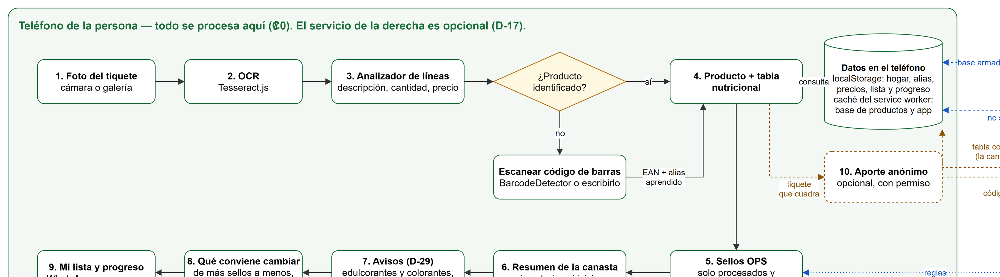
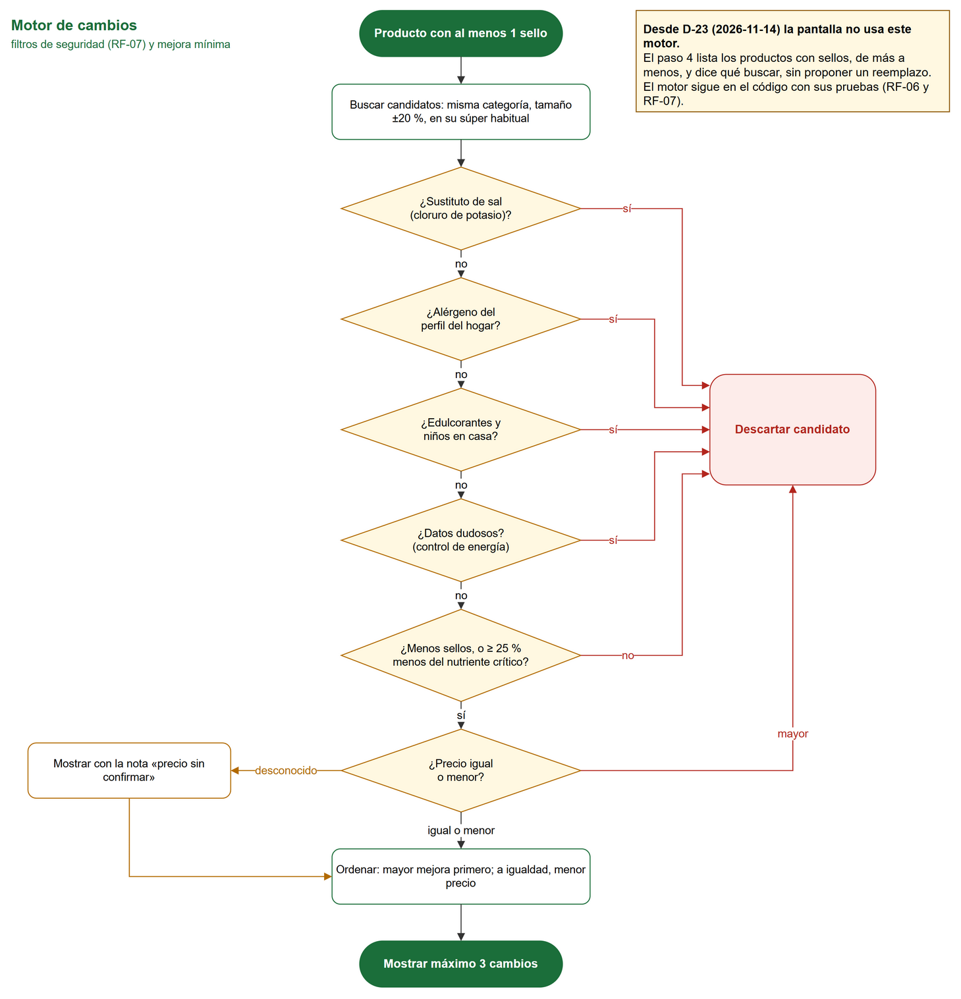
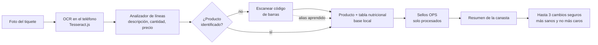

# Arquitectura — Canasta sana (borrador, 2026-11-13)

## Idea central
Una PWA que hace **todo dentro del teléfono**. No hay servidor propio. Las bases abiertas se descargan una vez y se usan sin conexión. Lo gratis también es lo más privado: los datos de compras, que revelan salud, nunca salen del teléfono.

## Flujo

Diagramas editables en `diagramas/canasta_sana.drawio`:

Versión en texto:

## Componentes

| # | Componente | Qué hace | Tecnología (gratis) |
|---|---|---|---|
| 1 | App | Interfaz con letra grande; instalable y sin conexión | React + Vite + TypeScript, service worker |
| 2 | OCR | Lee la foto en el teléfono | Tesseract.js, con preprocesado de la imagen (gris, contraste, enderezar) |
| 3 | Analizador | Separa descripción, cantidad y precio. Une varias fotos. Ignora el encabezado y el pie, donde van los datos personales. | Reglas por cadena (expresiones regulares) |
| 4 | Identificación | Busca la línea en los alias aprendidos y luego hace búsqueda difusa en la base. Si duda, pide el código de barras. | Búsqueda difusa en JS; lector de códigos con BarcodeDetector o ZXing |
| 5 | Base local | Productos de Costa Rica con nutrientes por 100 g, categoría, ingredientes y alérgenos. Alimentos frescos genéricos. Precios. | JSON en IndexedDB, generado por un script de Python desde Open Food Facts |
| 6 | Motor OPS | Calcula los sellos de cada producto procesado | TypeScript puro, con pruebas unitarias |
| 7 | Motor de cambios | Propone alternativas con reglas de seguridad | TypeScript puro, con pruebas unitarias |
| 8 | Aportes | Envía a Open Food Facts u Open Prices lo que falte, con consentimiento | API pública de esos proyectos |
| 9 | Alojamiento | Sirve la app | GitHub Pages o Azure Static Web Apps (plan gratis) |

## Datos para el prototipo

| Capa | Contenido | Fuente | Marca |
|---|---|---|---|
| 1 | 2 263 productos de Costa Rica con tabla nutricional | Open Food Facts, descarga única | Real (aportado por voluntarios) |
| 2 | Alimentos frescos (arroz, frijoles, frutas, verduras, carnes) | Tabla pública de composición de alimentos (licencia `POR VERIFICAR`) | Genérico |
| 3 | Tiquetes y precios de ejemplo | Script generador | `SIMULADO` |

Control de calidad de la capa 1: la energía declarada debe cuadrar con 4 × carbohidratos + 4 × proteína + 9 × grasa (kcal por 100 g), con una tolerancia de ±20 % (`SUPUESTO`). Los productos que no cuadran se marcan como dudosos y no se usan para sugerir cambios.

## Motor OPS: modelo de perfil de nutrientes (2016)

Umbrales `POR VERIFICAR` contra el documento oficial de la OPS antes de programarlos:

| Sello | Criterio |
|---|---|
| Exceso de sodio | ≥ 1 mg de sodio por 1 kcal |
| Exceso de azúcares libres | ≥ 10 % de la energía total |
| Exceso de grasas totales | ≥ 30 % de la energía total |
| Exceso de grasas saturadas | ≥ 10 % de la energía total |
| Exceso de grasas trans | ≥ 1 % de la energía total |
| Contiene edulcorantes | Cualquier cantidad |

- **Alcance:** solo productos procesados y ultraprocesados. Frutas, verduras, carnes frescas, arroz y frijoles no llevan sellos.
- **Azúcares libres:** no vienen en la etiqueta. Se estiman con el método de la OPS a partir de los azúcares totales y los ingredientes (`POR VERIFICAR`), y la app explica que es una estimación.

## Motor de cambios
Para cada producto con sellos:
1. **Candidatos:** misma categoría de Open Food Facts, tamaño ±20 % y presencia en el súper habitual, si se conoce.
2. **Filtros duros (RF-07):**
   - Rechaza productos con cloruro de potasio u otro sustituto de sal.
   - Rechaza alérgenos del perfil.
   - Rechaza edulcorantes si hay niños en el hogar.
   - Rechaza datos dudosos.
3. **Mejora:** menos sellos, o el mismo número con al menos 25 % menos del nutriente crítico (`SUPUESTO`).
4. **Precio:** igual o menor si se conoce. Si no se conoce, el cambio se muestra con la nota «precio sin confirmar».
5. **Orden:** mayor mejora primero; a igualdad, menor precio. Se muestran como máximo 3 cambios por canasta.

## Lo que queda fuera del prototipo
- Panel para nutricionistas de EBAIS (necesitaría servidor, consentimiento y revisión ética).
- Conteo de calorías y planes individuales: nunca.
